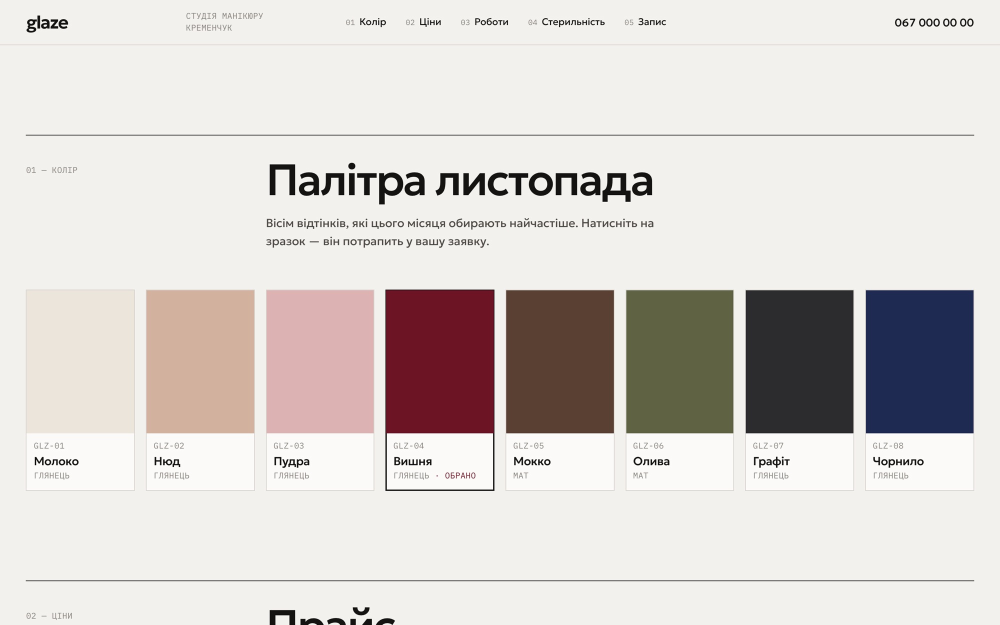
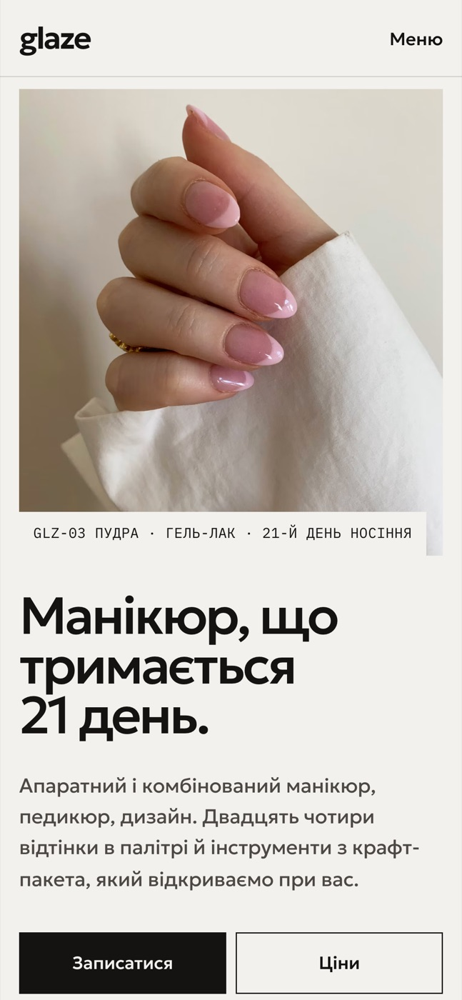
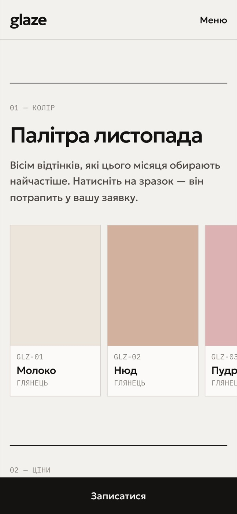

# glaze

**A website concept for a nail studio, built like a colour catalogue.**

A strict 12-column grid, hairline rules, a grotesk paired with a mono for codes. Lacquer swatches GLZ-01…08 are the hero, the price list is a real table with time and price, and booking uses day and time buttons. Designed and built from scratch — no frameworks, no build step.

[Live site](https://ttjelky.github.io/nail-studio-landing/) · [Case study](https://ttjelky.github.io/portfolio/en/work/glaze/)

&nbsp;

## Highlights

- **Colour as the hero** — eight lacquer swatches with codes and finish; tap one and it lands in the booking request
- **Trust through sterility** — a section on the four steps of tool sterilisation
- **Prices as a table** — service, time and price on one line, grouped into manicure, pedicure and nail art
- **Booking without dropdowns** — service, day and time picked with buttons, taken slots struck through

**Design & development:** [Oleksii Bezklynskyi](https://ttjelky.github.io/portfolio/) — I build websites for local businesses. Photos: Unsplash.

---

## Для розробника (UA)

Односторінковий сайт студії манікюру в стилі каталогу кольорів: строга сітка на 12 колонок, гротеск Geologica і моно IBM Plex Mono для кодів. Головний експонат — зразки лаку з кодами GLZ-01…08 (обраний колір потрапляє в заявку). Прайс-таблиця з часом і ціною, галерея робіт, блок про стерильність, майстри списком, запис із вибором дня й часу кнопками. Адаптований під телефон.

Сайт: https://ttjelky.github.io/nail-studio-landing/

Без фреймворків і збирання: `index.html` + `styles.css` + `script.js`.

### Як адаптувати під клієнта (30–60 хв)

1. **Назва.** Заміни `glaze` (логотип у шапці й підвалі, `<title>`, мета-теги).
2. **Кольори й шрифти.** Блок `:root` на початку `styles.css`: `--wine` — акцент, `--paper` — фон, `--ink` — текст, `--sans` / `--mono` — шрифти (Geologica + IBM Plex Mono, обидва з кирилицею).
3. **Палітра.** Зразки в секції `#colors` — кнопки `.chip`: колір у `style="--c:#…"`, код і назва в `data-code` / `data-name`. Для темних кольорів додай клас `chip--dark`.
4. **Ціни.** Таблиця в секції `#prices`; послуги у формі запису (радіокнопки `name="service"`) онови теж. Зайняті слоти часу — атрибут `disabled`.
5. **Контакти.** Телефон `+380670000000`, адреса, Instagram, Telegram, параметр `q=` у карті.
6. **Фото.** Зараз — безкоштовні фото з Unsplash. Для клієнта поклади його фото в `img/` і заміни `src`. Перший екран, роботи й майстри — вертикальні 4:5 або 3:4.
7. **Форма.** У демо заявка лише показує «Дякуємо». Для робочої версії підключи Telegram-бота або Formspree.
8. Прибери рядок «Демо-сайт» у підвалі.

### Оновлення

Після зміни `styles.css` або `script.js` збільш номер версії в `index.html` (`styles.css?v=3` → `?v=4`), інакше браузери до 10 хвилин показуватимуть старі стилі з кешу.
